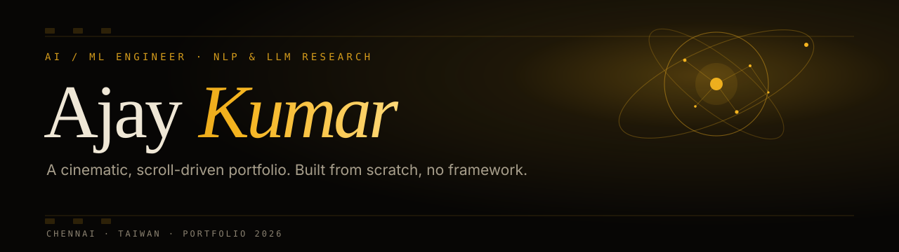
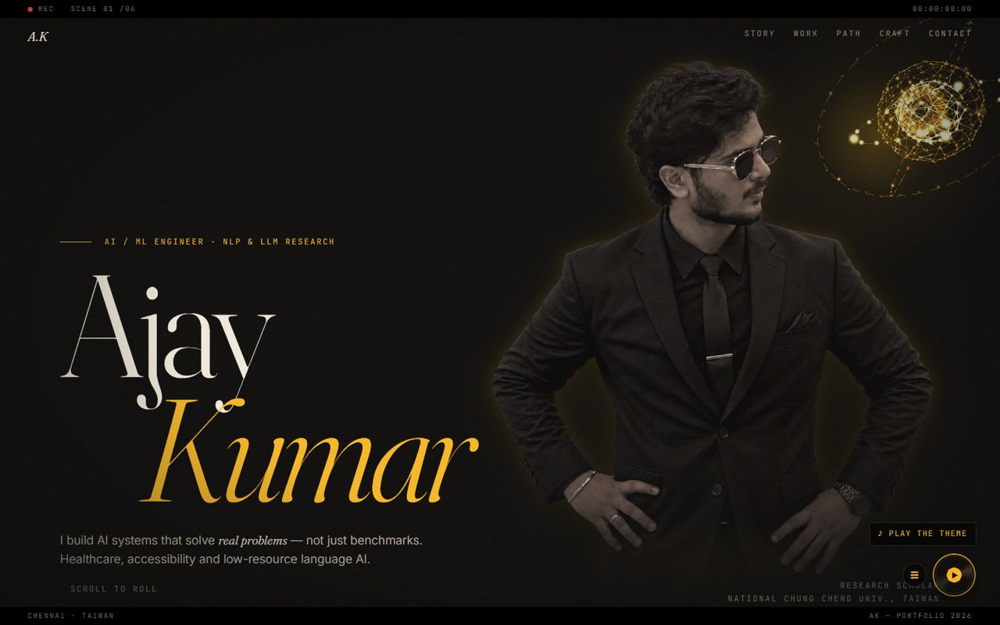
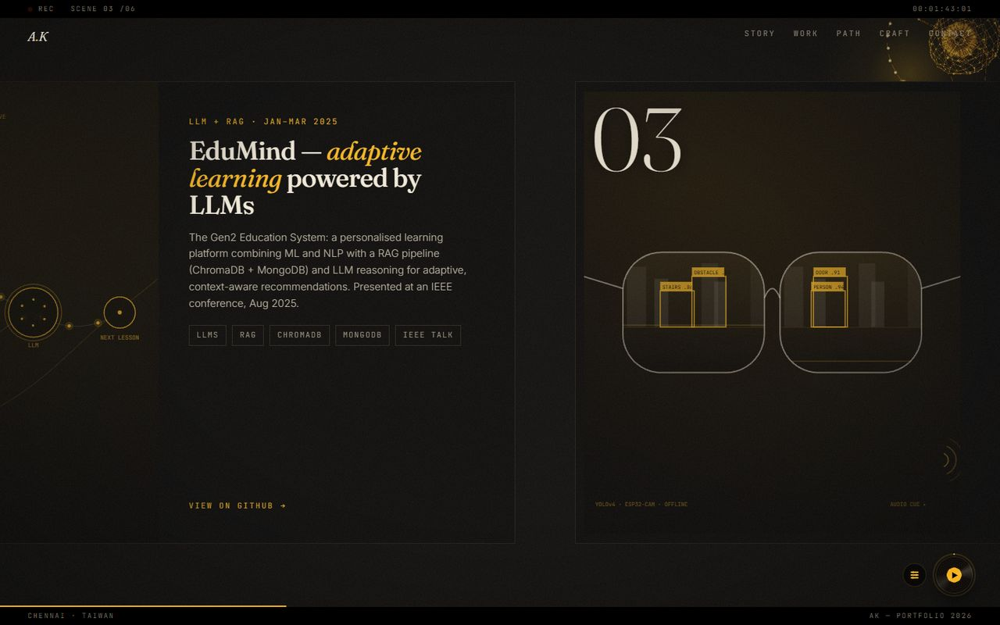
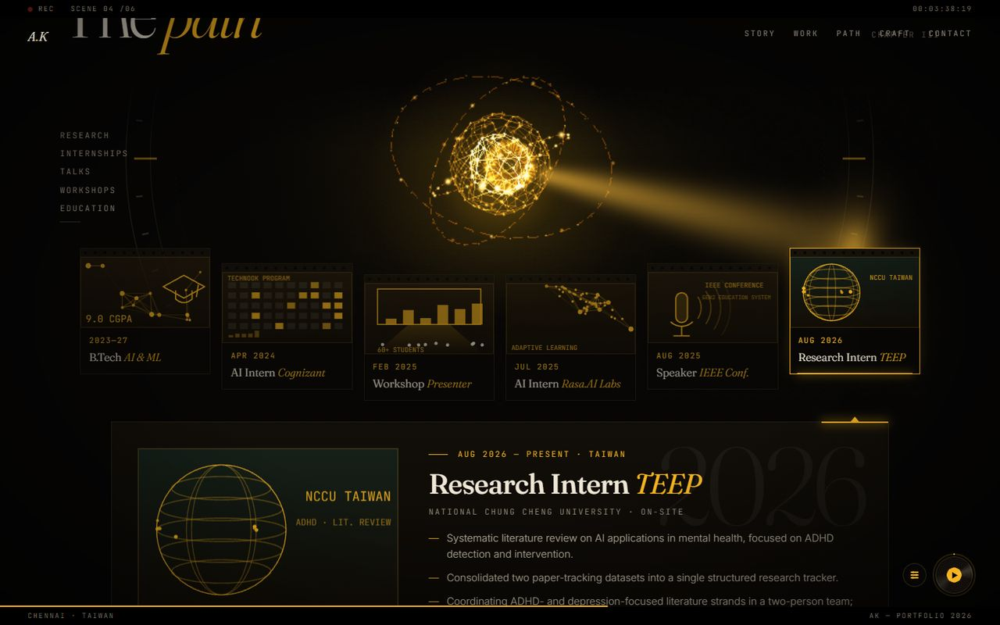
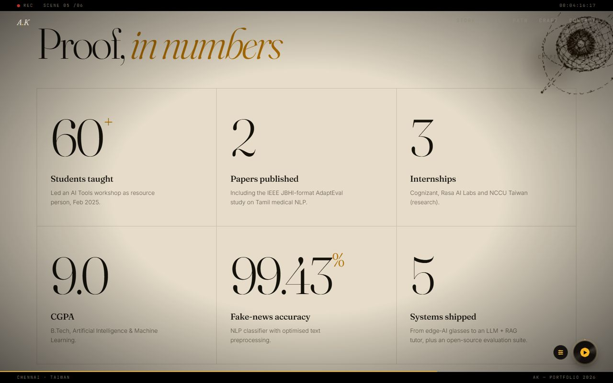
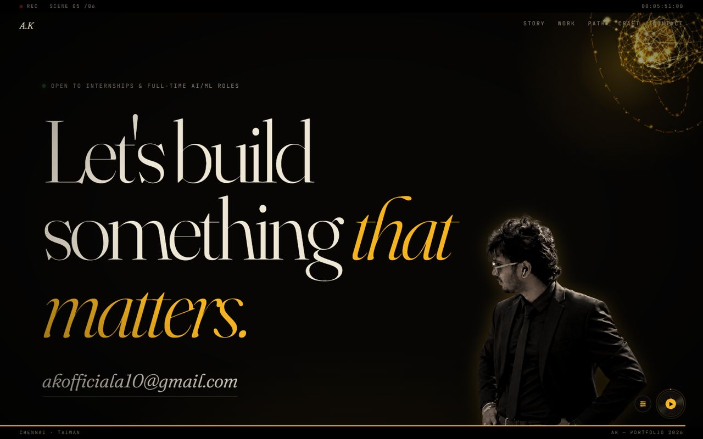

<div align="center">



<br>


**A film-noir portfolio you scroll like a short film.**
A living WebGL eye, a timeline that fires a beam of light, and a name that shatters into metal.

[](https://ajaykumar-ml.vercel.app/)

</div>

<br>

<p align="center">
  
</p>

## The tour

| Scene | What happens |
| :-- | :-- |
| **Story** | A title card. Hover the name (tap it on a phone) and the letters break into a frozen, metallic shatter, then pull back together. |
| **Manifesto** | The statement resolves word by word as you scroll. |
| **Work** | A pinned horizontal gallery. Each project opens through an inset frame, with a live canvas artwork behind it. |
| **Path** | Education, internships, talks and research on a film strip. The eye flies down, docks on the clock and fires a soft beam at the chapter you pick. One fixed-size screen shows the details, so nothing grows, scrolls or flips. |
| **Craft** | Skills slide past in horizontal reels that light up near your cursor. |
| **Proof** | A bone-paper panel of numbers that count up. The eye switches to ink so it stays readable on the pale background. |
| **Contact** | A closing portrait and a headline that rises line by line. |

Between the scenes, eased multi-stop gradients carry the page from black through amber and gold to cream and back, so there are no hard edges.

<p align="center">
  
  
</p>
<p align="center">
  
  
</p>

## Details worth poking at

- **The eye.** A Three.js sphere of synapses that follows the cursor, blinks, spins with scroll, and shatters when you click it. It travels down the page's margins and docks on the Path clock.
- **The beam.** Rendered per pixel on a small canvas (a Gaussian cone plus an inverse-square pool of light), so it stays soft instead of banding.
- **The name shatter.** Dependency-free WebGL: every glyph becomes shards with procedural metal shading. Hover on desktop, tap on touch screens.
- **The music disc.** A spinning record in the corner plays the first minute of a theme. Click to play or pause; open the deck for mute, volume and a timeline you can drag anywhere. It loops with a fade at the seam and remembers your choice.
- **Film-camera HUD.** A REC light, a running timecode and a scene counter follow you down the page.

## Built to stay smooth

Most of the engineering is invisible. It is there so the page holds its frame rate on an integrated GPU:

- **Adaptive quality.** A frame-rate watchdog trims the eye's resolution and drops the decorative full-screen layers only if the machine genuinely can't keep up, and only after start-up work has settled.
- **Baked, not blurred.** The hero portrait's colour grade and drop-shadows are baked into the image, so the GPU is not re-blurring a photo-sized shadow on every scroll frame.
- **Lazy by default.** The music file, the shatter shaders and the shatter-glow image are prepared when the browser is idle after the intro, or the moment they are first needed.
- **Work only when seen.** Canvas artworks run at slow, adaptive rates and only while on screen. Layout is read only when the eye is near the sections that need it.
- **Graceful fallbacks.** Reduced-motion is respected, a blocked CDN falls back to a plain scrollable layout, and the layout switches to a dedicated mobile design below 900 px.
- **Keyboard and screen readers.** The Path timeline is a proper tablist (←/→/Home/End), controls have labels, and focus states are visible.

## Project structure

```
.
├── index.html        markup, all CSS, and the main script (intro, scroll choreography, counters, HUD)
├── js/
│   ├── relic.js      the WebGL eye: scroll path, docking, shatter, post-processing
│   ├── path.js       the Path section: film strip, fixed screen, light beam, keyboard support
│   ├── thumbs.js     procedural canvas artwork for the work scenes and Path frames
│   ├── player.js     the music disc: play/pause, mute, volume, seekable minute
│   └── shatter.js    the metallic name shatter (WebGL, hover and tap)
├── assets/           baked portraits (WebP) and the theme clip
├── docs/             README banner and screenshots
└── vercel.json       caching and security headers
```

Libraries load from a CDN: [GSAP](https://gsap.com) + ScrollTrigger, [Lenis](https://lenis.darkroom.engineering) and [Three.js](https://threejs.org). There is no `package.json`, bundler or build step.

## Run it locally

Any static file server works. From the project folder:

```bash
python -m http.server 4173
```

Then open <http://localhost:4173>. Use a desktop-width window: the layout intentionally changes below 900 px.

## Deploy

The repository root is the site, so it deploys as-is on any static host. On **Vercel**: import the repo, set *Framework Preset* to **Other**, and leave the build command and output directory empty. `vercel.json` adds caching and security headers.

Files in `js/` are cached for a year. When you change one, bump the `?v=` number on its `<script>` tag in `index.html`.

## Contact

**Ajay Kumar** · AI/ML engineer, NLP &amp; LLM research · Chennai / Taiwan

[Email](mailto:akofficiala10@gmail.com) · [LinkedIn](https://www.linkedin.com/in/ajay-kumar-124215372/) · [GitHub](https://github.com/AjayKumar-repo)

<sub>© 2026 Ajay Kumar. The portraits and written content are not licensed for reuse.</sub>
